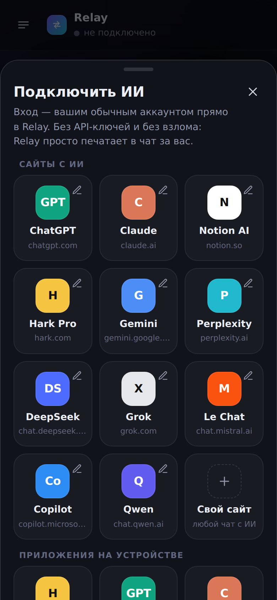
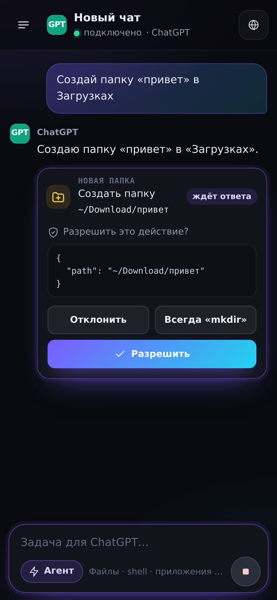
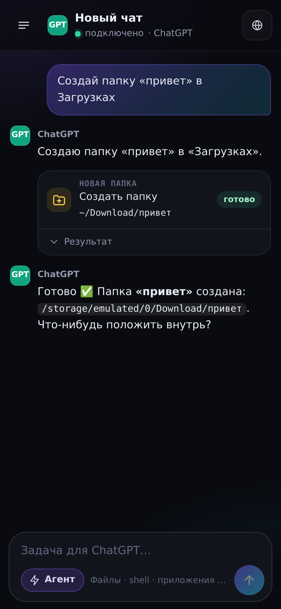
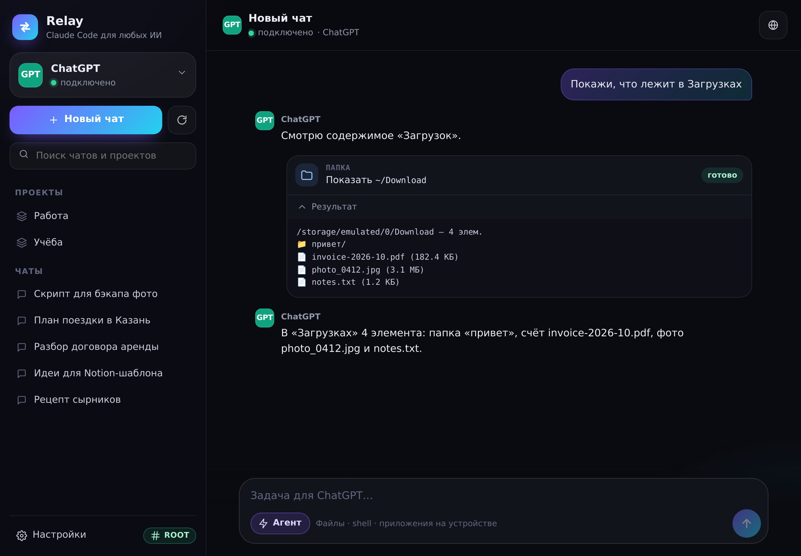

# Relay — «Claude Code» для любых ИИ

Android-приложение для телефона и планшета (с root и без). Вы пишете задачу в Relay — она уходит **в чат выбранного ИИ-сервиса** (ChatGPT, Claude, Notion AI, Hark Pro, Gemini, Perplexity, DeepSeek… или любой свой сайт/приложение), а действия, которые ИИ решит выполнить («создай папку *привет* в Загрузках»), **выполняются на вашем устройстве** — после вашего подтверждения.

Без API-ключей и без взлома: Relay открывает обычный сайт или приложение под вашим аккаунтом и печатает в чат за вас, как если бы вы делали это руками.

| Подключение | Подтверждение действия | Результат | Планшет |
|---|---|---|---|
|  |  |  |  |

> Скриншоты сняты с того же интерфейса в браузере с демо-хостом (`mock.js`), а не с телефона.

## Как это работает

```
 Relay (ваш промпт)
   │  1. текст + инструкция для ИИ
   ▼
 Сайт ИИ во встроенном браузере (ваш аккаунт)     или     Приложение ИИ (через спец. возможности)
   │  2. ответ ИИ, в нём блоки ```relay {"tool": "mkdir", ...}```
   ▼
 Relay: разбирает вызовы → спрашивает вас → выполняет на устройстве (файлы, shell, root, приложения)
   │  3. «[Relay • результат] …» уходит обратно в тот же чат
   └──► повторяется, пока ИИ не ответит «готово» (как агентный цикл Claude Code)
```

* **Сайты** открываются во встроенном WebView с вашей сессией. Скрипт `relay-core.js` находит поле ввода, вставляет текст, жмёт «Отправить», ждёт окончания ответа и читает его. Чаты и проекты сервиса показываются в боковой панели Relay.
* **Приложения без сайта/коннектора** (например, Hark Pro на Android) управляются через службу спец. возможностей: Relay открывает приложение, вставляет текст, нажимает «Отправить» и читает новый текст с экрана.
* **MCP-сервер**: те же инструменты телефона доступны по протоколу MCP в вашей Wi‑Fi сети — например, для Claude Code на компьютере.

## Возможности

* Выбор сервиса из пресетов или **свой сайт** — для любого веб-чата (корпоративный бот, Open WebUI, локальная модель).
* Список **чатов и проектов** сервиса, новый чат, переключение между чатами.
* **Агент / Чат**: в режиме агента ИИ может вызывать инструменты, в режиме чата — только переписка.
* Инструменты: `list_dir`, `read_file`, `search_files`, `write_file`, `mkdir`, `move`, `copy`, `delete`, `shell` (в т.ч. от root), `open_url`, `launch_app`, `device_info`. Пути `~`, `/sdcard`, «Загрузки», «Документы» понимаются автоматически.
* **Подтверждения** как в Claude Code: «Разрешить / Всегда / Отклонить». Удаление и shell нельзя разрешить «навсегда». Режимы: спрашивать всё, авто для чтения, без вопросов.
* **Root**: Relay сам выдаёт себе «Доступ ко всем файлам» и включает службу спец. возможностей; при нехватке прав файловые операции повторяются через `su`. Без root всё работает через обычные системные разрешения.
* **Настройка любого сайта без кода**: в редакторе сервиса нажмите 🎯 и просто тапните на сайте поле ввода, кнопку «Отправить», ответ ИИ, чат в списке — Relay сам построит CSS-селекторы. Кнопка «Проверить» показывает, что найдено.
* Тёмный интерфейс для телефона, на планшете — двухпанельный режим.

## Установка

1. Скачайте APK: **Actions → Android → последний запуск → артефакт `relay-apk`** (или соберите сами, см. ниже).
2. Установите (разрешите установку из этого источника).
3. Откройте Relay → «Выбрать ИИ» → например, ChatGPT → кнопка 🌐 → войдите в аккаунт один раз.
4. Настройки → «Доступ ко всем файлам» (с root выдаётся автоматически).
5. Напишите: *«Создай папку «привет» в Загрузках»* → подтвердите действие.

Для приложений (Hark Pro и др.): Настройки → «Спец. возможности» → включить Relay. На Android 13+ без root сначала: *Настройки → Приложения → Relay → ⋮ → Разрешить ограниченные настройки*.

### MCP для Claude Code

Настройки → MCP-сервер → включить. Скопируйте готовую команду, например:

```bash
claude mcp add --transport http relay-phone http://192.168.1.42:8765/mcp --header "Authorization: Bearer <токен>"
```

Каждый вызов из MCP тоже подтверждается на телефоне (по режиму подтверждений).

## Ограничения (честно)

* Сайты меняют вёрстку: встроенные селекторы — «лучшее приближение» и могут устареть. Если отправка/чтение не работает — редактор сервиса → 🎯 → тапните элементы заново. Без селекторов работает автоопределение (поле ввода, Enter, ответ по разнице текста страницы).
* Пресеты не проверялись на живых аккаунтах этих сервисов — проверено на тестовом чат-сайте (см. ниже).
* Вход через Google внутри встроенного браузера Google может блокировать — используйте вход по почте или приложение через раздел «Приложения».
* Пока ИИ отвечает, держите Relay открытым: в фоне Android замедляет страницы.
* Каждая сборка из Actions подписана своим debug-ключом — при обновлении из другого запуска может понадобиться удалить старую версию.

## Разработка

```
app/src/main/java/dev/relay/agent/
  RelayController.kt     связка UI ↔ сайты/приложения ↔ агент ↔ MCP
  MainActivity.kt        оболочка: UI-WebView поверх WebView сайтов
  agent/                 ToolProtocol (формат ```relay```), AgentLoop (цикл агента, подтверждения)
  tools/                 ToolExecutor (файлы, shell, root-фолбэк), Shell
  mcp/                   McpServer — Streamable HTTP MCP без зависимостей
  site/SiteSession.kt    сайт ИИ во WebView
  nativeapp/             служба спец. возможностей и управление приложениями
app/src/main/assets/
  inject/relay-core.js   драйвер сайтов (ввод, отправка, чтение ответа, список чатов, «тапни элемент»)
  adapters.json          пресеты сервисов
  ui/                    интерфейс (HTML/CSS/JS); mock.js — демо-хост для браузера
tools/web-test/          проверки relay-core.js на фейковом чат-сайте + сценарии UI со скриншотами
```

```bash
./gradlew testDebugUnitTest assembleDebug          # JVM-тесты ядра + APK (нужны JDK 17 и Android SDK 35)
cd tools/web-test && npm ci && npx playwright install chromium && node run.mjs   # проверки в Chromium
```

Демо интерфейса в браузере: раздайте `app/src/main/assets` любым статическим сервером и откройте `/ui/index.html` (`?fresh=1` — с экрана приветствия).
