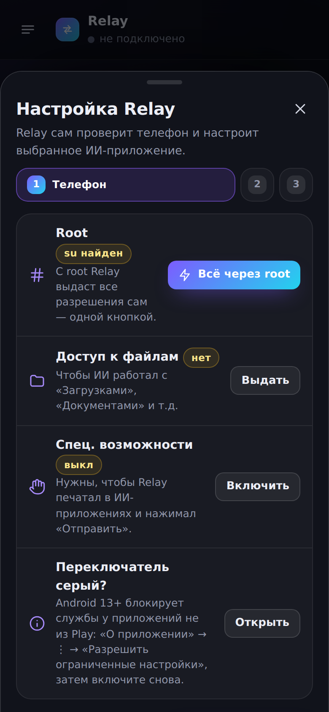
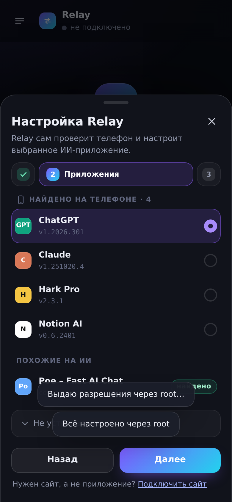
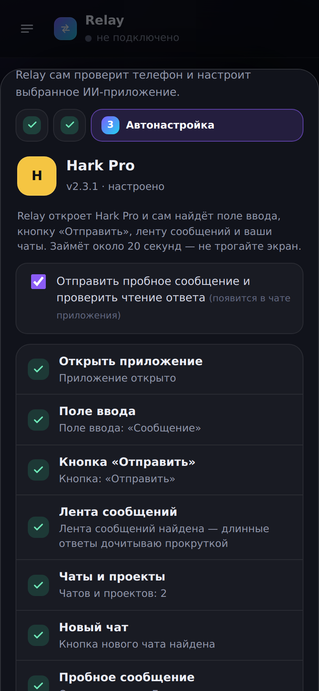
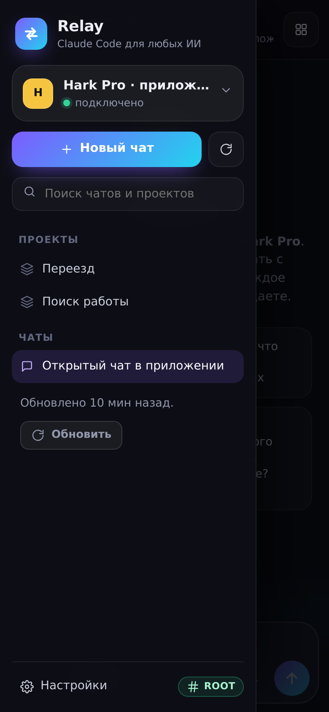
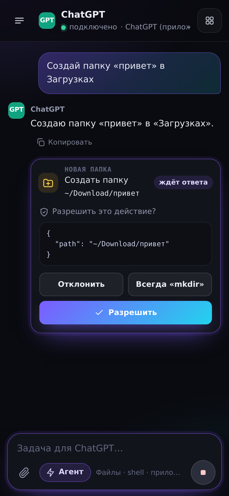
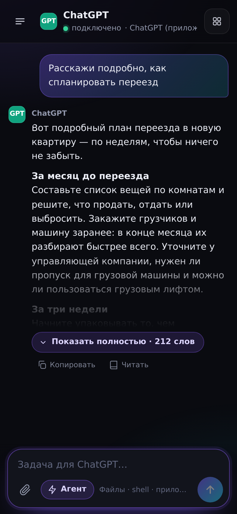
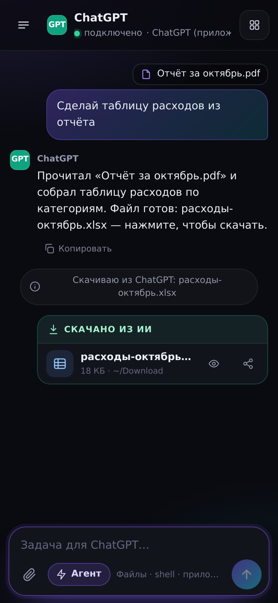
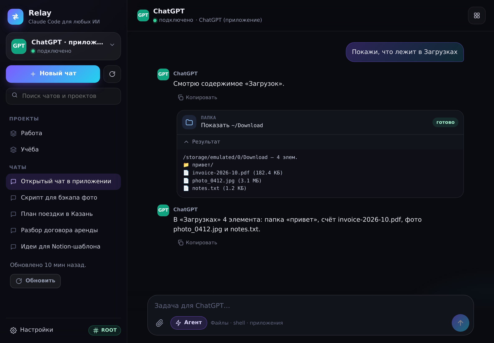

# Relay — «Claude Code» для любых ИИ-приложений

Android-приложение для телефона и планшета (с root и без). Вы пишете задачу в Relay, она уходит **в чат выбранного ИИ-приложения**: ChatGPT, Claude, Notion, Hark Pro, Gemini, Perplexity, DeepSeek, Grok, Copilot, Le Chat, ГигаЧат, Алиса — или любого другого приложения или сайта. Действия, которые ИИ решит выполнить («создай папку *привет* в Загрузках»), **выполняются на телефоне** после вашего подтверждения.

API-ключи не нужны, ничего не взламывается: Relay работает с обычным приложением под вашим аккаунтом — печатает, нажимает «Отправить» и читает ответ, как сделали бы вы сами.

| Мастер настройки | Найденные приложения | Автонастройка | Чаты приложения |
|---|---|---|---|
|  |  |  |  |

| Подтверждение действия | Длинный ответ | Файл от ИИ | Планшет |
|---|---|---|---|
|  |  |  |  |

> Скриншоты сняты с интерфейса приложения в браузере с демо-хостом (`mock.js`), не с телефона.

## Первый запуск: всё настраивается само

1. **Телефон.** Relay проверяет root, доступ к файлам и спец. возможности. С root достаточно одной кнопки «Всё через root»: Relay сам выдаёт себе доступ к файлам, включает свою службу и отключает ограничения батареи. Без root — по кнопке на каждое разрешение, с подсказкой для Android 13+ («Разрешить ограниченные настройки»).
2. **Приложения.** Relay ищет на телефоне известные ИИ-приложения (с версиями) и другие, похожие на ИИ. Для не установленных есть кнопка «Установить» — она открывает Google Play.
3. **Автонастройка выбранного приложения.** Relay открывает приложение и сам находит поле ввода и кнопку «Отправить» (печатает пробное слово и смотрит, какая кнопка появилась), ленту сообщений, меню со списком **чатов и проектов** и кнопку нового чата. По желанию отправляет пробное сообщение и проверяет, что ответ читается. Найденное запоминается; если приложение обновилось, автонастройку можно запустить заново.

## Как это работает

```
Relay (ваш промпт + файлы)
  │ 1. открывает приложение ИИ (или чат из списка), вставляет текст, жмёт «Отправить»
  ▼
ИИ-приложение (ваш аккаунт) — управление через спец. возможности Android
  │ 2. ждёт конца ответа, дочитывает его целиком, вызовы ```relay {"tool": …}``` → Relay
  ▼
Relay: подтверждение → действие на телефоне (файлы, shell, root, приложения, скачивание)
  │ 3. «[Relay • результат] …» уходит обратно в тот же чат — и так до «готово»
```

### Длинные ответы, которые не помещаются на экран

* **В ИИ-приложении** Relay показывать ничего не нужно. Если ответ длиннее экрана, Relay прокручивает ленту вверх до вашего сообщения, склеивает страницы и прокручивает обратно. Потом нажимает у ответа кнопку «Копировать» и берёт полный текст в разметке — с блоками кода. Ваш буфер обмена после этого восстанавливается.
* **В Relay** длинный ответ сворачивается до превью с кнопкой «Показать полностью · N слов». Есть режим «Читать» на весь экран и «Копировать».
* Если сайт настраивается вручную (🎯), достаточно тапнуть **любую видимую часть** ответа: Relay сам найдёт все ответы этого вида.

### Файлы

* **Вы → ИИ.** Кнопка 📎 в Relay или «Поделиться → Relay» из любого приложения. В ИИ-приложение файл уходит через системное «Поделиться» прямо в его чат, на сайт — как обычная загрузка файла. Если приложение не принимает файлы (например, «Поделиться» в Notion создаёт страницу), текстовые файлы вставляются в сообщение.
* **ИИ → вы.**
  * Текст и код ИИ сохраняет инструментом `write_file`.
  * Файлы по ссылке скачиваются инструментом `download_file`.
  * Если ИИ сгенерировал PDF, таблицу или картинку, Relay сам нажимает «Скачать» в ответе (настройка «Скачивать файлы из ответов»). Новые файлы в «Загрузках», «Документах» и «Картинках» появляются карточкой с кнопками «Открыть» и «Поделиться», а ИИ получает их пути и может продолжить с ними работу.
* **ИИ просит ваш файл.** Инструмент `attach_file`: файл с телефона прикрепляется к следующему сообщению — после вашего подтверждения.

### Инструменты агента

`list_dir`, `read_file`, `search_files`, `write_file`, `mkdir`, `move`, `copy`, `delete`, `shell` (в т.ч. от root), `download_file`, `attach_file`, `open_file`, `open_url`, `launch_app`, `device_info`.

Подтверждения работают как в Claude Code: «Разрешить», «Всегда», «Отклонить». Удаление и shell нельзя разрешить «навсегда».

### Ещё

* **Сайты.** Любой веб-чат с ИИ во встроенном браузере. Работают загрузки, выбор файлов и настройка «тапни элемент» (🎯).
* **MCP-сервер.** Те же инструменты телефона для Claude Code на компьютере в той же Wi‑Fi сети:
  ```bash
  claude mcp add --transport http relay-phone http://192.168.1.42:8765/mcp --header "Authorization: Bearer <токен>"
  ```
* **Снимок экрана для отладки** (Настройки → приложение) сохраняет в «Загрузки» JSON с тем, что Relay «видит» в приложении. Если что-то не находится, этот файл помогает исправить эвристики.

## Установка

1. APK: **Actions → Android → последний запуск → артефакт `relay-apk`** (или соберите сами, см. ниже).
2. Установите и откройте — запустится мастер настройки.

## Ограничения (честно)

* Relay управляет приложениями через спец. возможности по эвристикам: ищет поле ввода, кнопки по подписям, ленту и меню. Их проверяют модульные тесты на синтетических экранах, похожих на ChatGPT; на реальных приложениях **на телефоне ещё не проверялось**. Если что-то не находится — запустите автонастройку заново или сохраните «Снимок экрана для отладки».
* Пока Relay работает в приложении, не трогайте экран: он сам переключается в приложение ИИ и обратно.
* Автоскачивание файлов из приложений — «лучшее усилие»: у каждого приложения своё окно просмотра файла.
* Вход через Google во встроенном браузере сайтов Google может блокировать — используйте приложение.
* Каждая сборка из Actions подписана своим debug-ключом: при обновлении из другого запуска может понадобиться удалить старую версию.

## Разработка

```
app/src/main/java/dev/relay/agent/
  RelayController.kt          связка UI ↔ приложения/сайты ↔ агент ↔ файлы ↔ MCP
  nativeapp/ScreenModel.kt    модель экрана + эвристики (поле ввода, «Отправить», ответ, чаты, файлы) — чистый Kotlin
  nativeapp/AppDriver.kt      управление приложением: отправка, чтение длинного ответа, чаты, автонастройка
  nativeapp/NativeAppTarget.kt вложения через «Поделиться», ответ через «Копировать», буфер обмена
  agent/                      протокол ```relay```, цикл агента, вложения
  tools/                      инструменты (файлы, shell/root, скачивание)
  files/FileTracker.kt        новые файлы на устройстве
  apps/AiApps.kt              распознавание ИИ-приложений среди установленных
  site/SiteSession.kt         сайт во WebView: загрузки, выбор файлов
app/src/main/assets/
  inject/relay-core.js        драйвер сайтов
  adapters.json               каталог приложений и сайтов
  ui/                         интерфейс; mock.js — демо-хост для браузера
tools/web-test/               проверки relay-core.js и сценарии интерфейса со скриншотами
```

```bash
<<<<<<< HEAD
./gradlew testDebugUnitTest assembleDebug          # JVM-тесты + APK (JDK 17, Android SDK 35)
cd tools/web-test && npm ci && npx playwright install chromium && node run.mjs
=======
./gradlew testDebugUnitTest assembleDebug          # JVM-тесты ядра + APK (нужны JDK 17 и Android SDK 35)
cd tools/web-test && npm ci && npx playwright install chromium && node run.mjs   # проверки в Chromium
# или с уже установленным Chrome: CHROME_PATH=/path/to/chrome node run.mjs
>>>>>>> 4cec581 (Fix cut-off chat list and thread scrolling, harden agent/MCP/site lifecycle)
```

Демо интерфейса в браузере: раздайте `app/src/main/assets` статическим сервером и откройте `/ui/index.html` (`?fresh=1` — первый запуск с мастером, `?adapter=app-gemini` — не установленное приложение).
